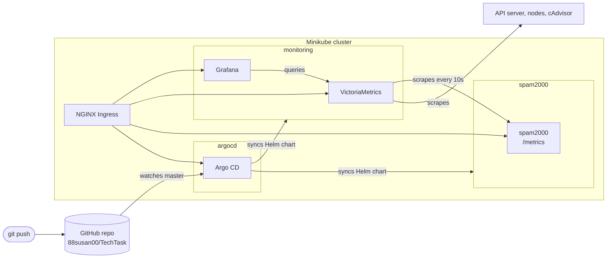

# TechTask: One-Command Kubernetes Monitoring Stack with GitOps

A single command spins up a local Kubernetes cluster, installs Argo CD and lets Argo CD deploy a full monitoring stack (VictoriaMetrics + Grafana) together with a sample application that exposes Prometheus metrics. After that, Git is the only source of truth: every change pushed to this repository is synced to the cluster automatically.

## What's inside

| Component | Role | Deployed as |
| --- | --- | --- |
| **Minikube** | Local single-node Kubernetes cluster with the NGINX Ingress addon | `bootstrap/install.sh` |
| **Argo CD** | GitOps controller: auto-sync, self-heal and prune | Upstream stable manifests |
| **VictoriaMetrics** (single) | Prometheus-compatible metrics collection and storage | Helm chart `victoria-metrics-single` 0.11.0 |
| **Grafana** | Dashboards, with datasource and dashboards provisioned as code | Helm chart `grafana` 7.3.0 |
| **spam2000** | Sample app that generates Prometheus metrics on `/metrics` | Custom Helm chart |

## Architecture



**How it works:**

1. `bootstrap/main.sh` starts Minikube, enables Ingress and installs Argo CD.
2. It applies two Argo CD `Application` resources (`argocd/monitoring.yaml`, `argocd/spam2000.yaml`) that point to the Helm charts in `apps/`.
3. Argo CD deploys both charts into their own namespaces and keeps them in sync with the `master` branch.
4. VictoriaMetrics discovers targets through Kubernetes service discovery. Any Service annotated with `prometheus.io/scrape: "true"` is scraped automatically.
5. Grafana picks up its datasource and dashboards from ConfigMaps through the sidecar, so no manual setup in the UI is needed.

## Quick start

### Prerequisites

| Tool | Version |
| --- | --- |
| Minikube | 1.30+ |
| kubectl | 1.28+ |
| Docker (Minikube driver) | Docker Desktop on macOS, Docker Engine on Linux |
| Helm (optional, for local chart testing) | 3.12+ |
| Bash | 4.0+ |

Resources for the cluster: **4 CPU, 4 GB RAM, ~20 GB disk**. Works on macOS (Intel and Apple Silicon), Linux and Windows with WSL2.

### Deploy everything

```bash
git clone https://github.com/88susan00/TechTask.git
cd TechTask
bash bootstrap/main.sh
```

The script prints the Argo CD admin password at the end. Give Argo CD 2–3 minutes to sync both applications.

### Step by step (optional)

```bash
bash bootstrap/install.sh             # start Minikube, enable Ingress, install Argo CD
bash bootstrap/wait-for-argocd.sh     # wait until argocd-server is Available
bash bootstrap/get-argocd-password.sh # print the initial admin password
bash bootstrap/apply-apps.sh          # apply Argo CD Applications and the Argo CD Ingress
```

## Access the UIs

### Option 1: port-forward (works everywhere)

| UI | Command | URL | Credentials |
| --- | --- | --- | --- |
| Argo CD | `kubectl port-forward -n argocd svc/argocd-server 8080:443` | https://localhost:8080 | `admin` / output of `get-argocd-password.sh` |
| Grafana | `kubectl port-forward -n monitoring svc/monitoring-grafana 3000:80` | http://localhost:3000 | `admin` / `admin` |
| VictoriaMetrics | `kubectl port-forward -n monitoring svc/monitoring-victoria-metrics-single-server 8428:8428` | http://localhost:8428/vmui | — |
| spam2000 metrics | `kubectl port-forward -n spam2000 svc/spam2000 3001:3000` | http://localhost:3001/metrics | — |

### Option 2: Ingress hostnames

The charts create Ingress rules for `grafana.local`, `victoriametrics.local`, `spam2000.local` and `argocd.local`. Point them to the cluster:

```bash
# Linux
echo "$(minikube ip) grafana.local victoriametrics.local spam2000.local argocd.local" | sudo tee -a /etc/hosts

# macOS with the Docker driver: run the tunnel in a separate terminal and use 127.0.0.1
minikube tunnel
echo "127.0.0.1 grafana.local victoriametrics.local spam2000.local argocd.local" | sudo tee -a /etc/hosts
```

## Dashboards

Two dashboards are provisioned automatically:

- **Kubernetes Cluster Monitoring** — cluster CPU, memory, filesystem and network usage, broken down by pods, containers and system services
- **spam2000 Metrics** — the application's gauges and counters over time, as a table and as a distribution

To add a dashboard, put its JSON into `apps/monitoring/dashboards/`, add it to `templates/dashboards-configmap.yaml` and push. Argo CD and the Grafana sidecar do the rest.

## Verify the deployment

```bash
kubectl get nodes                          # 1 node, Ready
kubectl get applications -n argocd         # monitoring and spam2000: Synced / Healthy
kubectl get pods -n monitoring             # VictoriaMetrics and Grafana: Running
kubectl get pods -n spam2000               # spam2000: Running
```

Check that metrics are being collected:

```bash
kubectl port-forward -n monitoring svc/monitoring-victoria-metrics-single-server 8428:8428 &
curl -s 'http://localhost:8428/api/v1/query?query=up{job="spam2000"}'
# expected: a result with value "1"
```

## Repository structure

```
TechTask/
├── bootstrap/                  # One-command setup
│   ├── main.sh                 # Runs all steps in order
│   ├── install.sh              # Minikube + Ingress addon + Argo CD
│   ├── wait-for-argocd.sh      # Waits for argocd-server
│   ├── get-argocd-password.sh  # Prints the initial admin password
│   └── apply-apps.sh           # Applies everything in argocd/
├── argocd/                     # Argo CD Applications (app-of-apps entry point)
│   ├── monitoring.yaml
│   ├── spam2000.yaml
│   └── argocd-ingress.yaml
└── apps/
    ├── monitoring/             # Umbrella chart: VictoriaMetrics + Grafana
    │   ├── Chart.yaml / Chart.lock / charts/
    │   ├── values.yaml         # Scrape config, Grafana settings, Ingress
    │   ├── dashboards/         # Grafana dashboards as JSON
    │   └── templates/          # Datasource, dashboards ConfigMaps, VM Ingress
    └── spam2000/               # Sample app chart: Deployment, Service, Ingress
```

## Scrape configuration

VictoriaMetrics scrapes every **10 seconds** (set in `apps/monitoring/values.yaml` → `scrape.config.global.scrape_interval`). Jobs:

| Job | Targets |
| --- | --- |
| `vmagent` | VictoriaMetrics itself |
| `kubernetes-apiservers` | Kubernetes API server |
| `kubernetes-nodes`, `kubernetes-nodes-cadvisor` | Node and container metrics (cAdvisor) |
| `kubernetes-service-endpoints` | Services annotated with `prometheus.io/scrape: "true"` |
| `kubernetes-service-endpoints-slow` | Services annotated with `prometheus.io/scrape_slow: "true"` (every 5 min) |
| `kubernetes-services` | Blackbox probes of Services |
| `kubernetes-pods` | Pods with Prometheus annotations |
| `spam2000`, `monitoring` | Dedicated jobs for these namespaces |

## Making changes (GitOps flow)

1. Edit a chart or values file in `apps/`.
2. Commit and push to `master`.
3. Argo CD detects the change and syncs it. Manual changes in the cluster are reverted by self-heal, and removed resources are pruned.

## Troubleshooting

| Symptom | Where to look |
| --- | --- |
| Minikube does not start | `minikube status`, `minikube logs` |
| Application stuck in `OutOfSync` or `Degraded` | `kubectl describe application -n argocd <name>`, `kubectl logs -n argocd -l app.kubernetes.io/name=argocd-application-controller` |
| No spam2000 metrics in Grafana | Check Service annotations: `kubectl get svc -n spam2000 spam2000 -o yaml`; check targets at http://localhost:8428/targets |
| VictoriaMetrics errors | `kubectl logs -n monitoring -l app.kubernetes.io/name=victoria-metrics-single-server` |
| `*.local` hostnames do not resolve | Check `/etc/hosts`; on macOS keep `minikube tunnel` running |

## Clean up

```bash
minikube delete
```

Or remove only the workloads:

```bash
kubectl delete applications -n argocd --all
kubectl delete namespace monitoring spam2000
```

## Notes and possible improvements

This is a local demo environment. For production I would:

- Move Grafana and Argo CD credentials out of `values.yaml` into a secrets manager (External Secrets, SOPS or Vault)
- Enable TLS on Ingress with cert-manager
- Add alerting rules (vmalert + Alertmanager) for target availability and resource saturation
- Set resource requests and limits for spam2000 and add liveness and readiness probes
- Pin Argo CD to a specific version instead of `stable`
- Turn `argocd/` into a single app-of-apps `Application` so the bootstrap applies only one resource
